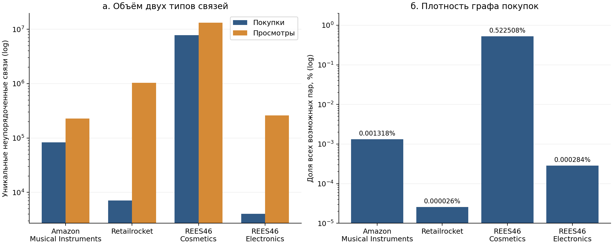
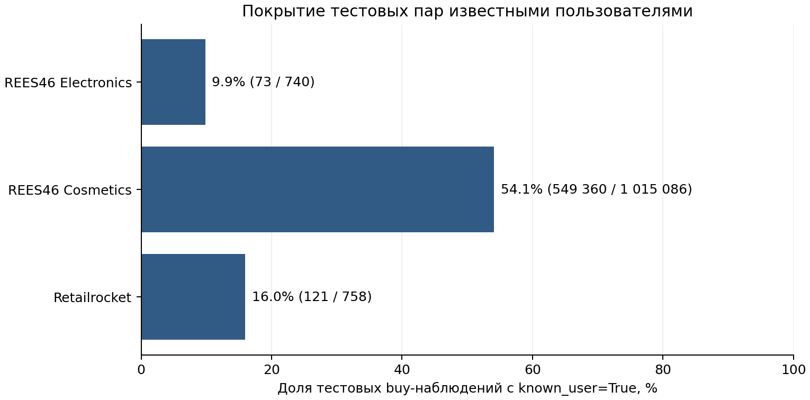

# Совместное обучение на покупках и просмотрах для рекомендации дополняющих товаров

Промежуточный научный отчёт · 21 ноября 2026 года

## Аннотация

В работе рассматривается рекомендация дополняющих товаров по исходному товару и заданной категории дополнения. Исследуется возможность использовать совместные просмотры как вспомогательный сигнал при недостатке совместных покупок. 
Предлагается сравнить двухбашенную модель с общим энкодером и отдельными головами для двух отношений (Shared) с обучением только на покупках, смешиванием отношений, последовательным предобучением и тензорной моделью Tucker с общими товарными факторами. 
На текущем этапе подготовлены четыре набора данных: Amazon Musical Instruments, Retailrocket, REES46 Cosmetics и REES46 Electronics; выполнены их анализ и разбиение. Аудит выявил существенные различия в плотности графов, доступности признаков и покрытии известных пользователей. Модельные прогоны выполнены на Amazon и двух наборах REES46. На Amazon эффект просмотров для Tucker зависит от доли покупок, а на когорте Cosmetics Tucker 4D уступил 3D по среднему NDCG@10.

**Ключевые слова:** рекомендательные системы, дополняющие товары, многозадачное обучение, two-tower, Tucker, неявная обратная связь.

## 1. Введение

Рекомендации в электронной коммерции должны учитывать характер связи между товарами. Пользователю, выбирающему гитару, могут быть полезны похожие гитары; после выбора инструмента актуальнее струны, чехол или тюнер. Первый сценарий связан с заменяемостью, второй — с дополняемостью. Сведение обоих сценариев к сходству товаров не гарантирует полезной выдачи: качественное дополнение может существенно отличаться от исходного товара по названию и категории.

Совместные покупки дают естественный, но неполный сигнал для обучения рекомендаций дополнений. Многие товары встречаются в покупках редко, тогда как просмотров заметно больше. Однако совместные просмотры могут отражать сравнение альтернатив, а не намерение купить товары вместе. Поэтому простое добавление просмотров к покупкам способно одновременно увеличить объём данных и исказить целевую задачу.

Цель проекта — выяснить, помогает ли совместное обучение на покупках и просмотрах ранжировать дополнения, особенно при разреженном графе покупок, и какой способ переноса сигнала обеспечивает лучшее соотношение качества и вычислительных затрат. Основной сценарий задаётся парой «исходный товар, категория дополнения» и возвращает до десяти товаров этой категории.

## 2. Обзор литературы

### 2.1. Предсказание отношений между товарами

McAuley, Pandey и Leskovec [1] формулируют восстановление отношений заменяемости и дополняемости как задачу предсказания связей. Их подход использует текст отзывов и характеристики товаров; тематические представления обучаются так, чтобы предсказывать и объяснять отношения. Эта работа показывает, почему тип отношения следует моделировать явно. В нашем проекте акцент смещён на использование просмотров как дополнительного обучающего сигнала при недостатке покупок и сравнение способов такого переноса

### 2.2. Двухбашенные рекомендации дополнений

В работе об Allegro [2] единая архитектура Two Tower адаптируется к похожим, дополняющим и вдохновляющим рекомендациям. В Complementary-TT запрос учитывает категорию дополнения, а обучение использует совместные покупки, отфильтрованные по эвристике дополняемости. Предварительное вычисление представлений кандидатов позволяет эффективно искать товары в векторном пространстве.

Этот подход служит архитектурной отправной точкой проекта. Однако промышленная система использует собственные данные, признаки и правила отбора категорий. Её результаты нельзя напрямую переносить на открытые журналы событий.

### 2.3. Тензорные модели с общими факторами

Tucker представляет многомерный массив через небольшое ядро и факторные матрицы. Обзор Kolda и Bader [3] систематизирует тензорные разложения и методы их вычисления, включая HOSVD. Для рекомендации это позволяет явно выделить ось отношения, а при наличии журналов — пользовательскую ось. Вместе с тем аппроксимация массива и ранжирование по неполным наблюдениям имеют разные цели: заполнение отсутствующих элементов нулями не превращает их в достоверные отрицательные примеры.

Peshekhonov, Arzhantsev и Rakhuba [4] исследуют SF-Tucker, в котором одинаковые по смыслу оси используют общие факторы, и предлагают риманов подход к оптимизации. Такая параметризация естественна для двух товарных осей. В проекте заимствуется идея общих факторов; воспроизведение риманова оптимизатора не входит в текущий план. Градиентный Tucker с BCE следует рассматривать как адаптацию параметризации к задаче рекомендаций.

## 3. Постановка задачи

Пусть $\mathcal I$ — каталог товаров, $\mathcal C$ — множество категорий, $c(i)$ — категория товара, $x_i$ — доступные признаки. Наблюдаются отношения $\mathcal E_{buy}$ и $\mathcal E_{view}$. Для Amazon это статические связи `also_buy` и `also_view`; для журналов событий — пары товаров, построенные внутри транзакций или сессий. Во втором случае дополнительно доступны пользователь $u$, группа событий $g$ и временные границы.

На вход подаются исходный товар $i$ и целевая категория $c$. Из допустимого множества

$$
\mathcal A(i,c)=\{j\in\mathcal I_{eval}:c(j)=c,\;j\ne i\}
$$

необходимо выбрать ранжированный список

$$
R_{10}(i,c)=\operatorname{TopK}_{j\in\mathcal A(i,c)}s_{buy}(i,j,c),
\qquad K=\min(10,|\mathcal A(i,c)|).
$$

Здесь $\mathcal I_{eval}$ определяется общими для методов правилами доступности товаров. В пользовательском расширении оценивается $s_{buy}(u,i,j,c)$. Целевая величина — качество восстановления отложенных buy-связей внутри заданной категории.

Приняты следующие предположения и ограничения:

1. **Покупка — приближённая разметка дополняемости.** Совместная покупка не доказывает функциональную совместимость, совместный просмотр также не обязательно означает заменяемость или дополняемость.
2. **Ненаблюдаемая связь не равна отрицательной.** Выбранные ненаблюдаемые пары используются как обучающий суррогат, а не как подтверждённо несовместимые товары.
3. **Типы источников различаются.** Amazon позволяет оценить восстановление статического графа, журналы — предсказание будущих совместных покупок. Эти задачи нельзя считать идентичными.
4. **Категория задана извне.** Проект не оценивает алгоритм выбора категории дополнения и не гарантирует техническую совместимость товара внутри категории.

## 4. Предлагаемое решение

### 4.1. Общий энкодер и отдельные головы

Общий энкодер $f_\theta$ преобразует признаки товара в представление $h_i=f_\theta(x_i)$. Для отношения $r\in\{buy,view\}$ используются отдельные головы запроса и кандидата:

$$
q_r(i,c)=g_r^{Q}([h_i;e_c]),\qquad
k_r(j)=g_r^{K}(h_j),\qquad
s_r(i,j,c)=q_r(i,c)^\top k_r(j),
$$

где $e_c$ — представление целевой категории. Общая часть должна переносить полезную информацию между отношениями, а головы — учитывать различия их семантики. Для выдачи используется только ветвь покупок.

Для нейросетевых моделей и градиентного Tucker используется бинарная кросс-энтропия на положительных и выбранных ненаблюдаемых связях:

$$
\mathcal L_r=-\frac{1}{|\mathcal D_r|}\sum_{(z,y)\in\mathcal D_r}
\left[y\log\sigma(s_r(z))+(1-y)\log(1-\sigma(s_r(z)))\right],
$$

$$
\mathcal L_{Shared}=\mathcal L_{buy}+\lambda\mathcal L_{view}.
$$

Коэффициент $\lambda$ выбирается на validation. Нормирование потерь по отношениям и правила формирования батчей необходимо фиксировать, поскольку объём просмотров существенно различается между наборами. В исправленной серии Amazon отрицательные пары выбираются по доступным связям train. Исторические Buy-only и Shared использовали список отложенных пар для исключения их из отрицательных примеров.

### 4.2. Схемы сравнения

| Модель | Обучающий сигнал и принцип | Назначение |
| --- | --- | --- |
| MostPopular | Популярность кандидатов в целевой категории по входящим buy-связям train | Проверка выигрыша относительно простого неперсонализированного ранжирования |
| Buy-only | Двухбашенная модель только на покупках | Базовая модель без переноса просмотров |
| Mixed | Покупки и просмотры обучают одно отношение | Проверка эффекта простого увеличения данных |
| Shared | Общий энкодер, отдельные головы buy/view | Основной вариант одновременного переноса |
| Pretrain → Buy | Предобучение на просмотрах, затем дообучение на покупках | Сравнение последовательного и совместного обучения |
| Transformer | Совместное кодирование пары, категории и токена `[BUY]` / `[VIEW]` | Более гибкое взаимодействие признаков и типов связи |
| Tucker 3D | Общие товарные факторы и отдельная ось отношения | Альтернатива на основе структуры связей |

Transformer оценивает пару совместно; его стоимость выдачи следует измерять отдельно от two-tower, где представления кандидатов можно вычислить заранее. Для Pretrain → Buy время обучения должно включать обе стадии.

### 4.3. Tucker с общими товарными факторами

Для тензора «исходный товар × кандидат × отношение» используется параметризация

$$
s_r(i,j)=\sum_{a=1}^{d}\sum_{b=1}^{d}\sum_{\ell=1}^{k}
G_{ab\ell}U_{ia}U_{jb}V_{r\ell},
$$

где $U\in\mathbb R^{|\mathcal I|\times d}$ — общая таблица товарных факторов, $V\in\mathbb R^{2\times k}$ — факторы отношений, $G\in\mathbb R^{d\times d\times k}$ — ядро. Категория в этой формулировке ограничивает множество кандидатов. Общие факторы не требуют симметричности оценки: без ограничения на ядро $s_r(i,j)$ и $s_r(j,i)$ могут различаться.

Без дополнительных смещений число параметров равно $|\mathcal I|d+2k+d^2k$. Замена двух независимых товарных матриц одной экономит $|\mathcal I|d$ параметров при тех же рангах. Это аналитическое сравнение параметризаций, а не измеренный выигрыш относительно Shared.

Дополнительно проверены усечённый HOSVD и Tucker 4D с пользовательской осью. Обычный HOSVD сам по себе не обеспечивает равенство факторов двух товарных осей; сравнение должно явно указывать ограничения, обработку ненаблюдаемых элементов и функцию оптимизации. Для 4D пользовательские факторы добавляются к тому же набору отношений, а сравниваемый 3D-вариант агрегирует пользовательскую ось. Полные плотные тензоры создавать не планируется.

Tucker использует идентификаторы и связи, тогда как нейросетевые модели могут использовать признаки товаров. Поэтому основное сравнение оценивает подходы целиком. Для отделения эффекта архитектуры от эффекта признаков полезна дополнительная абляция с сопоставимым входом.

## 5. Данные, гипотезы и экспериментальный сетап

### 5.1. Источники и предобработка

**Amazon Review Data 2018, Musical Instruments [5].** Используются метаданные товаров. Ноутбук сохраняет идентификатор, название, описание, путь категории и конечную категорию. Повторные идентификаторы удаляются; `also_buy` и `also_view` разворачиваются в таблицу отношений. Исключаются самосвязи, повторные направленные пары одного типа, кандидаты за пределами каталога и пары без категорий. Времён взаимодействий и пользователей в этом источнике нет.

**Retailrocket [6].** После удаления дублей и некорректных событий время переводится в UTC. Сессия начинается после паузы более 30 минут. Категория присоединяется по последней доступной записи свойств не позднее события (`merge_asof`, направление `backward`). Co-buy строятся внутри `(user_id, transactionid)`, co-view — внутри `(user_id, session_id)`.

**REES46 Cosmetics и Electronics [7, 8].** CSV объединяются, идентификаторы читаются без потери целочисленной точности, время приводится к UTC, дубли и некорректные события удаляются. Для обоих отношений используется `(user_id, session_id)`; покупки берутся из `purchase`, просмотры — из `view`. События корзины не образуют отдельного отношения. Cosmetics включает файлы октября 2019 — февраля 2020 года; используемый файл Electronics содержит события, в том числе, сентября 2020 — февраля 2021 года.

Для журналов внутри каждой группы выбираются уникальные товары и строятся все неупорядоченные пары. Просмотровые группы более чем с 50 различными товарами исключаются целиком, чтобы ограничить квадратичный рост. Для покупок такой порог сейчас не установлен, так как таких событий явно меньше. Пары без категорий удаляются. Одна товарная пара может повторяться у разных пользователей и в разные моменты: число строк здесь не равно числу уникальных связей.

### 5.2. Реализованное разбиение

**Amazon.** При `seed=42` неупорядоченные buy-пары случайно распределяются примерно в пропорции 80/10/10. Оба направления одной пары остаются вместе. Все validation/test-пары удаляются из обучающих buy и view; список сохраняется в `holdout_pairs.csv.gz`. В validation/test остаются покупки, оба товара которых встречаются в train. На проверенных файлах пересечение train с holdout и validation с test по неупорядоченным ключам равно нулю.

**Журналы событий.** Границы выбираются по 80-му и 90-му процентилям упорядоченных корректных событий, то есть делается глобальное временное разбиение. Сессии, а в Retailrocket также транзакции, пересекающие границы, исключаются целиком; исключение распространяется на связанные группы до стабилизации. Train включает buy/view, validation/test — только buy-пары известных товаров. `known_user` отмечает пользователей, встречавшихся в сохранённых train-событиях. Повторение связи в более позднем периоде допускается, поскольку оценивается будущее поведение, а не только новые рёбра.

### 5.3. Проверяемые гипотезы

| Гипотеза | Эксперимент | Критерий проверки |
| --- | --- | --- |
| H1. Просмотры полезны | Shared против Buy-only | Улучшение NDCG@10 и Recall@10 при общем протоколе |
| H2. Типы связей нужно различать | Shared против Mixed | Выигрыш отдельных голов при сопоставимом бюджете |
| H3. Одновременный перенос лучше последовательного | Shared против Pretrain → Buy | Сравнение качества с учётом обеих стадий обучения |
| H4. Тензорная модель конкурентоспособна | Tucker 3D против MostPopular и Buy-only | Выигрыш относительно обеих базовых моделей |
| H5. Перенос важнее при дефиците покупок | Доли buy-train 100%, 50%, 25% | Рост разности качества Shared/Tucker и Buy-only |
| H6. Tucker экономичнее при сопоставимом качестве | Tucker 3D против Shared | Отклонение качества в заранее заданном допуске при меньших времени и числе параметров |

Основной контролируемый эксперимент с разреженностью проводится на Amazon: подвыборки покупок вложены и одинаковы для методов; просмотры, тест и состав оцениваемых объектов фиксированы. MostPopular пересчитывается для каждой доли. Эксперименты с долями 100%, 50% и 25% выполняются через scripts/run_study.py, в ноутбуке сохранена итоговая сводка. Для Electronics проверена переносимость выводов, на когорте Cosmetics сравниваются 3D и 4D.

### 5.4. Метрики и условия сравнения

Для запроса $q=(i,c)$, либо $q=(u,i,c)$ в 4D, пусть $Y_q$ — множество релевантных отложенных товаров после общих фильтров, а $R_q$ — первые десять кандидатов. Используются

$$
\operatorname{Recall@10}(q)=\frac{|R_q\cap Y_q|}{|Y_q|},
$$

$$
\operatorname{DCG@10}(q)=\sum_{t=1}^{\min(10,|R_q|)}
\frac{\mathbf 1[R_{q,t}\in Y_q]}{\log_2(t+1)},\qquad
\operatorname{NDCG@10}(q)=\frac{\operatorname{DCG@10}(q)}
{\sum_{t=1}^{\min(10,|Y_q|)}1/\log_2(t+1)}.
$$

Recall характеризует полноту восстановления дополнений, NDCG дополнительно учитывает их позиции. Метрики макроусредняются по запросам с непустым $Y_q$. Оценщик также возвращает HitRate@10 — долю запросов, для которых в топ-10 есть хотя бы один релевантный кандидат, и долю исходных запросов, прошедших фильтры.

Кандидаты и правила исключения должны быть одинаковыми для всех сравниваемых методов. Предпочтителен полный доступный каталог целевой категории; если потребуется сэмплирование кандидатов, его протокол нужно явно описать. Временные признаки каталога следует брать только из доступного прошлого. Для 3D/4D сравнения используются одни и те же пользовательские запросы; оценка 3D не зависит от пользователя.

Гиперпараметры выбираются по validation при сопоставимом бюджете настройки. Для градиентных моделей предусмотрены три инициализации, среднее качество и разброс. Дополнительно измеряются число обучаемых параметров, время обучения и выдачи на одинаковом оборудовании; для методов с предвычислением нужно отдельно учитывать подготовку представлений. Абсолютные значения метрик разных датасетов напрямую не сравниваются.

## 6. Текущие результаты и выводы

### 6.1. Масштаб и разреженность данных

Таблица 1 содержит результаты сохранённого выполнения `dataset_analysis.ipynb` до разбиения и окончательного отбора каталога.

**Таблица 1. Подготовленные данные и число связей.**

| Набор | Товаров | Buy-наблюдений | View-наблюдений | Уникальных buy-пар | Уникальных view-пар | Плотность buy, % |
| --- | ---: | ---: | ---: | ---: | ---: | ---: |
| Amazon Musical Instruments | 112 135 | 85 710 | 244 651 | 82 893 | 227 621 | 0,001318 |
| Retailrocket | 235 061 | 7 758 | 1 317 240 | 7 052 | 1 034 911 | 0,000026 |
| REES46 Cosmetics | 54 571 | 11 521 008 | 23 839 097 | 7 779 980 | 13 113 113 | 0,522508 |
| REES46 Electronics | 53 453 | 5 517 | 431 927 | 4 053 | 260 116 | 0,000284 |

Уникальные пары считаются без направления. Для Amazon наблюдение — направленная ссылка метаданных; для журналов — пара внутри конкретной группы пользователя. Число товаров берётся из всей подготовленной таблицы товаров Amazon или событий журналов, включая объекты без buy-соседей. Плотность рассчитывается как

$$
\rho_{buy}=100\cdot\frac{|E_{buy}^{undirected}|}{n(n-1)/2}.
$$

Это плотность относительно всего подготовленного каталога, а не только допустимых пар категорий.

*Рисунок 1. Уникальные связи двух типов и плотность покупок. Обе вертикальные шкалы логарифмические. Источник: таблица 1; графики построены для данного отчёта.*

Уникальных view-связей больше buy-связей примерно в 2,75 раза для Amazon, 146,75 раза для Retailrocket, 1,69 раза для Cosmetics и 64,18 раза для Electronics. Следовательно, перенос просмотров особенно интересно проверять на Retailrocket и Electronics. Однако количество дополнительных связей само по себе не свидетельствует об их полезности.

Cosmetics значительно плотнее других наборов. Это даёт иной режим данных, но не доказывает более высокую точность разметки дополнений.

### 6.2. Размеры разбиений и покрытие пользователей

**Таблица 2. Фактические размеры сохранённых CSV-разбиений, seed 42.**

| Набор | Train: buy | Train: view | Validation: buy | Test: buy | Товаров в `train_items` |
| --- | ---: | ---: | ---: | ---: | ---: |
| Amazon | 68 568 | 243 871 | 8 195 | 8 243 | 50 540 |
| Retailrocket | 5 871 | 1 014 808 | 974 | 758 | 212 915 |
| REES46 Cosmetics | 8 583 649 | 18 409 579 | 1 121 086 | 1 015 086 | 51 338 |
| REES46 Electronics | 3 453 | 318 580 | 926 | 740 | 50 175 |

В таблице 2 указано число наблюдений пар после разбиения и фильтрации: train содержит покупки и просмотры, а validation и test — только покупки. Повторения одной пары в разных группах событий учитываются отдельно; последний столбец показывает число товаров, отмеченных как известные по обучающей части.

При перепрогоне Retailrocket явный разбор ISO 8601 сохранил 2 837 корректных событий без дробной части секунды, которые ранее исключались при автоматическом выводе формата. Поэтому изменились временные границы и размеры его разбиений.

**Таблица 3. Известные пользователи в сохранённых отложенных парах.**

| Набор | Validation: пары с `known_user=True` | Доля validation | Test: пары с `known_user=True` | Доля test |
| --- | ---: | ---: | ---: | ---: |
| Retailrocket | 331 / 974 | 33,98% | 121 / 758 | 15,96% |
| REES46 Cosmetics | 813 093 / 1 121 086 | 72,53% | 549 360 / 1 015 086 | 54,12% |
| REES46 Electronics | 87 / 926 | 9,40% | 73 / 740 | 9,86% |

В таблице 3 числитель — количество пар с пользователем, встречавшимся в train-событиях, знаменатель — общее количество пар в соответствующей части. Эти доли показывают, какая часть наблюдений проходит пользовательский фильтр для оценки 4D-модели.

*Рисунок 2. Доля тестовых buy-наблюдений с пользователями, известными по train-событиям.*

На рисунке 2 видно, что этот фильтр сохраняет около 54% тестовых пар Cosmetics, но лишь 16% Retailrocket и 10% Electronics. Поэтому сравнивать 3D и 4D нужно на одном и том же подмножестве, учитывая небольшой объём оценки на двух последних наборах.

### 6.3. Результаты моделей

| Сравнение | Средний NDCG@10 |
| --- | ---: |
| Amazon, HOSVD при 100% покупок | 0,525 |
| Amazon, Tucker buy-only / buy+view при 100% покупок | 0,444 / 0,439 |
| Amazon, Tucker buy-only / buy+view при 50% покупок | 0,382 / 0,385 |
| Amazon, Tucker buy-only / buy+view при 25% покупок | 0,309 / 0,315 |
| REES46 Electronics, HOSVD при 100% покупок | 0,296 |
| REES46 Cosmetics, Tucker 3D / 4D на одной когорте | 0,277 / 0,191 |

В этом пилоте просмотры для Tucker дают небольшой прирост при сокращении числа покупок, а на полной обучающей выборке Amazon эффект отрицательный. Персонализированный Tucker 4D показал больший разброс между инициализациями. Этот вывод относится к выбранной когорте активных пользователей Cosmetics.

Сравнение исправленного Mixed с историческим Shared меняет протокол обучения вместе с головами модели, поэтому вклад раздельных голов по нему не выделяем. Pretrain и Transformer остаются в плане. Отчёт не оценивает физическую совместимость товаров: релевантность определена по отложенным покупкам.

[Промежуточный PDF](interim-report.pdf) содержит таблицы качества и затрат. Сводки лежат в [results](results/), порядок запуска и источники данных приведены в [README](../README.md).

## Список литературы

1. McAuley J., Pandey R., Leskovec J. **Inferring Networks of Substitutable and Complementary Products.** KDD, 2015. [Текст работы](https://arxiv.org/abs/1506.08839).
2. Osowska-Kurczab A., Nazarko K., Marzec M., Wojciechowska L., Kremeňová E. **Suggest, Complement, Inspire: Story of Two Tower Recommendations at Allegro.com.** RecSys, 2025. [Текст работы](https://arxiv.org/abs/2508.03702). [DOI](https://doi.org/10.1145/3705328.3748135).
3. Kolda T. G., Bader B. W. **Tensor Decompositions and Applications.** SIAM Review, 51(3):455–500, 2009. [DOI и публикация](https://doi.org/10.1137/07070111X).
4. Peshekhonov I., Arzhantsev A., Rakhuba M. **Training a Tucker Model With Shared Factors: a Riemannian Optimization Approach.** AISTATS, PMLR 238:3304–3312, 2024. [Публикация](https://proceedings.mlr.press/v238/peshekhonov24a.html).
5. Ni J. **Amazon Review Data (2018).** Раздел Musical Instruments, метаданные товаров. [Страница набора](https://cseweb.ucsd.edu/~jmcauley/datasets/amazon_v2/).
6. Retailrocket. **Retailrocket recommender system dataset.** [Набор данных](https://www.kaggle.com/datasets/retailrocket/ecommerce-dataset).
7. Kechinov M. / REES46. **eCommerce Events History in Cosmetics Shop.** [Используемый набор](https://www.kaggle.com/datasets/mkechinov/ecommerce-events-history-in-cosmetics-shop).
8. Kechinov M. / REES46. **eCommerce Events History in Electronics Store.** [Используемый набор](https://www.kaggle.com/datasets/mkechinov/ecommerce-events-history-in-electronics-store).

